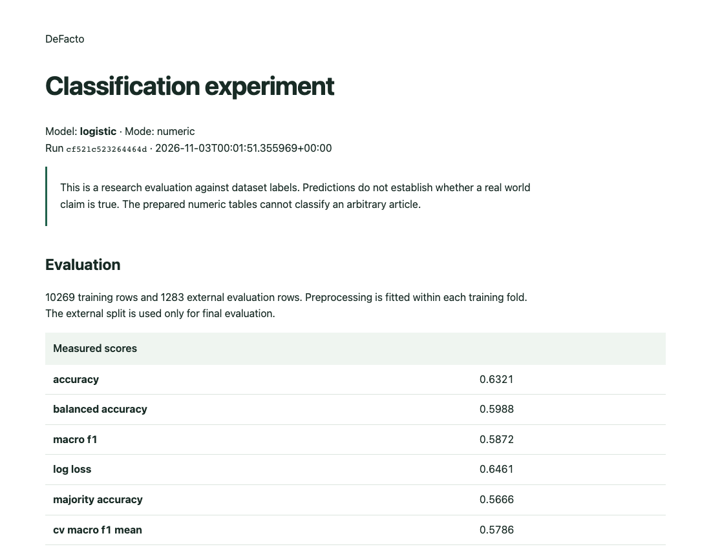

# DeFacto

Reproducible classification experiments with Python, Pandas, Scikit learn, and SQL reporting.

DeFacto evaluates classifiers on the prepared feature tables already in this repository. It records the data fingerprints, training settings, measured scores, predictions, and confusion matrices for each experiment. The original R experiments remain available alongside the Python workflow.



## Run an experiment

Use Python 3.11 or newer in a virtual environment.

```bash
python -m venv .venv
source .venv/bin/activate
pip install -e '.[dev]'
defacto inspect --train binary_training.csv
defacto train --train binary_training.csv --test binary_testing.csv --folds 3
```

The command prints the run ID and artifact directory. Open its `report.html` in a browser. The same directory contains `run.json`, `predictions.csv`, and a locally trained `model.joblib`. SQL records are stored in `artifacts/experiments.sqlite`.

Only load model files from a trusted source. Joblib model files can execute Python when loaded.

## What is implemented

1. Input validation, explicit target columns, matching feature schemas, dataset hashes, and descriptive split diagnostics.
2. Logistic regression, random forest, and a small neural network baseline. Preprocessing is fitted inside each training fold.
3. An external evaluation split, a majority class baseline, macro F1, balanced accuracy, log loss, and an accuracy uncertainty interval.
4. A transactional SQL experiment store, a summary view, class error queries, and stable CSV exports.
5. An HTML experiment report and CSV tables for Tableau and Power BI. The Power Query import function and DAX measures are in `bi/`.
6. Prediction from saved models, compatible experiment comparisons, and permutation importance diagnostics.

## Measured baseline

On the supplied binary feature tables, the logistic baseline with seed 42 and three training folds measured 0.6321 accuracy and 0.5872 macro F1 on 1,283 evaluation rows. The majority baseline measured 0.5666 accuracy. Training used 10,269 rows.

The three class baseline measured 0.4965 accuracy. The six class baseline measured 0.3289 accuracy. These are measurements from the supplied splits, with no claim about performance on new articles or current news.

## Data and evaluation limits

The bundled CSV files contain prepared numeric features rather than raw article text. Original statement IDs and the full upstream preprocessing process are unavailable in these tables. The new workflow reports matching feature rows across splits, but numeric matches alone cannot establish duplicate statements.

`Search` is excluded by default because its collection timing needs independent verification. All remaining feature availability and dataset provenance should also be checked before making a deployment claim. The external test split is reserved for evaluation; comparing models on it is exploratory and should not become a tuning loop.

```bash
defacto audit --train binary_training.csv --test binary_testing.csv
defacto train --train three_training.csv --test three_testing.csv --folds 3
defacto train --train multi_training.csv --test multi_testing.csv --folds 3
defacto train --train binary_training.csv --test binary_testing.csv --model forest --folds 3
defacto export --database artifacts/experiments.sqlite --output artifacts/bi
```

For a separately supplied text dataset, `--mode text --text-column Statement` trains a TF IDF and logistic regression pipeline. Exact text overlap between training and evaluation is rejected. No raw text corpus is bundled here.

## Inspect a saved run

Replace `RUN_ID` with the printed identifier.

```bash
defacto report --run-id RUN_ID --output artifacts/report.html
defacto predict --model artifacts/RUN_ID/model.joblib --input binary_testing.csv --output artifacts/predicted.csv
defacto explain --model artifacts/RUN_ID/model.joblib --test binary_testing.csv
defacto compare --run-ids FIRST_RUN SECOND_RUN
```

Permutation importance describes predictive reliance, not causal effects. The bootstrap interval describes sampling uncertainty for a fixed model and does not measure dataset shift or training variability.

## Development

```bash
ruff check src tests
pytest -q
```

CI runs the tests and a real dataset training smoke check. The R files are legacy experiments with their own local paths and package requirements. They are preserved for inspection; the Python CLI is the portable entry point.
